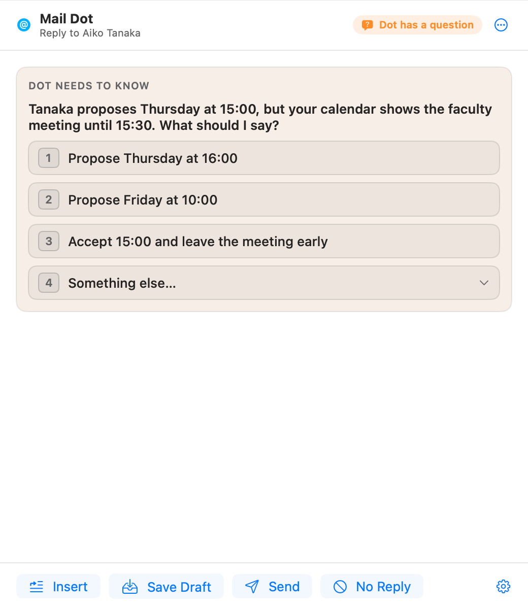
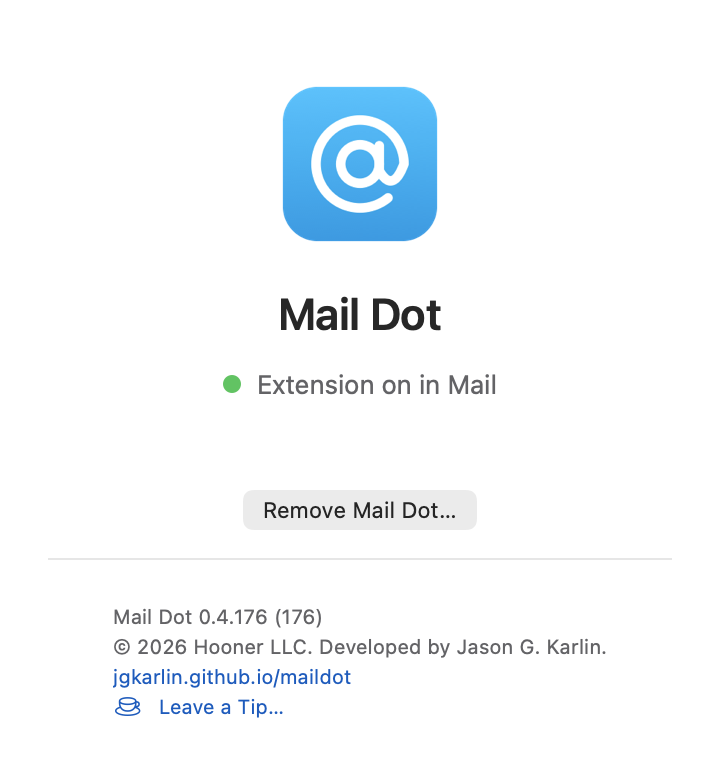

# Mail Dot

Mail Dot is an extension for Apple Mail on the Mac that brings Dot, the assistant in ChatGPT, into the mail client. It drafts replies that draw on the whole context of a correspondence, it answers questions about a mailbox in plain language, and it reports on each thread so that the state of a matter is visible at a glance. The reader works in Mail throughout. Nothing is sent until the reader presses Send, and by default Mail Dot asks for one confirmation before the message goes.

Hooner LLC publishes Mail Dot's source code under the PolyForm Noncommercial License 1.0.0. Anyone may use, study and modify it for noncommercial purposes, and commercial use requires a licence from Hooner LLC. The installer is on the [Releases page](https://github.com/JGKarlin/maildot/releases).

<p align="center"></p>

## Why Mail Dot exists

Dot can already read and write mail through ChatGPT. Managing the mail of several accounts from a chat window, or by voice alone, is nevertheless unrealistic for most working days. Mail involves scanning lists, opening threads, comparing messages and editing text in place, and a mail client does all of this better than a conversation does. The mail client therefore remains necessary.

Apple's mail client, however, has changed little since the early days of mailbox-based mail programs. Its search matches words and cannot answer a question. Its drafting help knows nothing of earlier correspondence, the calendar or the documents a reply depends on. The integration of language models into the client is still lacking, both for composing drafts and for searching by meaning.

Mail Dot joins the two. Mail remains the place where mail is read, sorted and sent. Dot supplies the reasoning, the writing and the search, and its work appears inside Mail on the message it concerns.

## Which accounts Mail Dot works with

Mail Dot follows one rule for mail accounts.

**Gmail and iCloud work only through their plugin connectors in ChatGPT.** A Gmail or Google Workspace account requires ChatGPT's Gmail connector, and an iCloud account requires ChatGPT's iCloud Mail connector. Mail Dot does not set these accounts up through Mail.

**Reading through Mail is only for accounts that have no connector.** An Exchange account, or an account on another IMAP service, has no plugin connector in ChatGPT, so Mail Dot reads it through Mail on the Mac, in the folders the reader allows.

| Account | How Dot reads it | How Dot searches it |
| --- | --- | --- |
| Gmail, Google Workspace | ChatGPT's Gmail connector, required | On Google's servers, through the connector |
| iCloud | ChatGPT's iCloud Mail connector, required | On Apple's servers, through the connector |
| Any account without a connector | Through Mail on the Mac | In Mail Dot's encrypted index on the Mac, with Search by Meaning as an option |

Mail sent to another address of a Gmail or iCloud mailbox, such as a second address that Mail knows only as an alias, also reaches Dot through that mailbox's connector. Mail Dot's settings show which route each account uses, and offer Use Gmail Connector… and Use iCloud Connector… to turn the connectors on. The sections below explain what each route means for search and for privacy.

## How Mail Dot protects mail

Mail Dot opens no new place where mail is exposed. Mail is handled in two places only: by Dot, and on the Mac. It is important to be exact about what each receives, because it differs by account.

Dot does receive mail. That is the purpose of Mail Dot, and it holds for every kind of account.

For a Gmail or an iCloud account, Dot reads mail through the connector for that service in ChatGPT. ChatGPT then connects to the provider directly: to Google through the sign-in the reader gives it, and to Apple through an app-specific password that the reader creates for iCloud Mail and adds in ChatGPT, which ChatGPT keeps in order to connect. Through that access Dot can read the whole mailbox on the provider's servers. Mail Dot does not hold that access, keeps no copy of that mail, and plays no part in what Dot may see there.

For an account that has no connector, such as an Exchange or other IMAP account, Dot reads through Mail on the Mac, and Mail Dot limits what it receives. Mail Dot searches its index on the Mac and sends Dot what the task needs: for a question in Ask Dot, short passages from the messages that match, and then the full text of those Dot chooses to read; for a draft or a report, the message and the thread it belongs to. Each request is limited. A search returns passages from at most 25 messages, and a read returns the full text of at most five, though Dot may make several requests to answer one question. Dot can reach only the folders the reader has allowed, and it never receives the index itself or a mailbox as a whole.

Whatever Dot reads, from any account, is handled by OpenAI under the reader's own ChatGPT account and OpenAI's terms.

What Mail Dot keeps for itself stays on the Mac and is protected there. Its search index, which holds text of the mail in the accounts read through Mail, is encrypted with SQLCipher under a key that is made on the Mac and held in the login Keychain, where only Mail Dot and its helper can read it. The embeddings of Search by Meaning are computed on the Mac by the language model built into macOS and stored inside that encrypted index. The index is kept out of Time Machine backups, and removing Mail Dot deletes the index and its key. Mail Dot has no server of its own, sends nothing to its publisher, and passes no mail to any cloud service other than the reader's own ChatGPT.

## What Mail Dot does

Mail Dot has three functions: drafting, search and reports.

### Drafting in context

When an important message arrives, or when the reader opens one, Mail Dot offers it to Dot. Dot reads the thread, consults earlier mail with the same person, the calendar and any other sources connected to it in ChatGPT, and writes a reply in the language of the message. The draft waits in Mail Dot's panel in the reply window. The reader inserts it into the message, saves it to Drafts, or sends it, and can ask Dot to revise it in a sentence or by voice.

Where the context does not settle what the reply should say, Dot asks one question and offers concrete answers. A single press answers it, and Dot then writes the draft. Mail Dot keeps the answer, so Dot does not ask the same question again, and a draft already written is shown before any question.

A request the reader makes, such as a reply asked for in the panel, an instruction to revise, a call or a question in Ask Dot, goes ahead of the automatic draft checks, and Mail Dot offers Dot no new automatic check while it waits. While Dot is starting, the panel's status line says how many requests are ahead of the reader's own.

<p align="center"></p>

<p align="center"></p>

Mail Dot filters what it offers to Dot. Bulk mail, mailing lists, receipts, account notices, one-time codes and automated messages stay out, and each account has its own switch for automatic drafts. The reader's own drafting rules, such as how to open a message or how formal to be, accompany every request, and so do notes on how to write to a particular person.

<p align="center"></p>

### Searching mail with Dot

Ask Dot is a floating bar, opened with Shift-Option-Command-F, that takes a question about the mailbox as a whole. The question may ask for a message ("find the file Priya sent about the budget") or for what the mail says about a matter ("when is the workshop, and who has confirmed?"). Filters narrow the search by account, period, direction, correspondent and attachments.

Dot answers in sentences. Every statement cites the message it rests on, and each citation opens that message in Mail. Mail Dot checks each cited message against Mail and marks any that Mail does not hold. Beneath the answer, a line for each account states what Dot searched there, so an account that was left out is visible. A filled check mark on that line means Mail Dot saw the search take place, which it can for an account read through Mail; an outlined one means it has only Dot's statement, as for a connector account. A history keeps earlier questions and their answers.

<p align="center"></p>

How the search is carried out depends on the account, and the difference matters.

A Gmail or Google Workspace account and an iCloud account each have a connector in ChatGPT, and with it a search service: the provider's own. Dot searches such an account through its connector, on the provider's servers, across the whole mailbox. Mail Dot builds nothing for these accounts and has nothing to switch on.

Gmail and iCloud require their connectors, and Mail Dot offers no other route for connecting them. Under Accounts in Mail Dot's settings, the row of a Gmail account that is not yet connected shows a Use Gmail Connector… button, and the row of an iCloud account shows Use iCloud Connector…. Each opens the connector's page in ChatGPT and asks Dot to confirm the connection once the reader has added it. Gmail asks for a Google sign-in; iCloud asks for an app-specific password created at Apple. Before the button is pressed, the row reads "Gmail connector not connected" or "iCloud connector not connected". While Dot checks the new connection, it reads "Asking Dot to confirm the connection…". Once Dot confirms, it reads "Gmail, through Dot's Gmail connector" or "iCloud, through Dot's iCloud connector"; if Dot cannot confirm, the row shows Dot's reason.

<p align="center"></p>

A Gmail or iCloud account cannot be newly set up through Mail. The one exception is an account that an earlier version of Mail Dot was already reading through Mail: it keeps working that way until its connector is confirmed, and Mail Dot then switches it over and removes its part of the index, with any embeddings.

Reading through Mail is reserved for accounts that have no connector, such as an Exchange or other IMAP account. Such an account has no search service that Dot can reach. Its mail exists for Dot only as Mail holds it on the Mac. Mail Dot therefore builds a search index for these accounts itself, on the Mac, covering the folders the reader has allowed and nothing else. The index holds each message's sender, date, subject and own text, without the history quoted beneath it. Mail Dot fills it in the background and keeps it in step with Mail, so that a deleted message leaves the index. The index is encrypted with SQLCipher. Its key is made on the Mac and kept in the login Keychain, readable only by Mail Dot and its helper. The index is excluded from Time Machine backups, and removing Mail Dot deletes both the index and its key.

By default this index finds messages by their words, in any language, Japanese included. Search by Meaning adds a second way of finding them. It is chosen for each account separately: under Accounts in Mail Dot's settings, every account read through Mail has a Search by Meaning checkbox beside its checkboxes for Mail Dot and for automatic replies. A Gmail or iCloud account has no such box, because Dot searches it through its connector and it needs neither the index nor the embeddings.

For an account whose box is ticked, Mail Dot turns each message into embeddings, which are numerical summaries of what a passage says, using the language model that Apple builds into macOS. A question then finds messages that concern the same matter even where they share no words with it, and Dot receives the results of both kinds of search together. Every box is unticked at first. The account's row shows how much of its mail has been taken in. Unticking the box removes that account's embeddings and leaves its mail in the word index.

<p align="center"></p>

Search by Meaning asks for Full Disk Access when the first box is ticked, for one reason: with that permission Mail Dot can read past mail directly from Mail's files, without Mail being open. macOS grants this permission for the whole disk and offers no narrower form. Mail Dot uses it for one place only, the Mail folder at `~/Library/Mail`, checks that every file it opens lies inside that folder, and writes nothing there. It skips junk and deleted mail. The embeddings are computed on the Mac and stored in the same encrypted index, and no mail is sent anywhere to produce them; macOS may download the language model itself from Apple the first time. Without Full Disk Access the box stays ticked, the settings say that the access is off, and Mail Dot reads mail through Mail as before, which works only while Mail is open.

### Reports on threads

For each message it handles, Dot reports on the thread: how it began, how it developed, what has been decided, what remains open and who must act. A banner on the message in Mail gives the state in a word or two. It reads "Checking" while Dot decides whether the message needs a reply, "Drafting" only while a reply is being written, and then "Draft ready", "Question for you" or "No reply needed". The Mail Dot window shows the full report. Once the reader has answered a message, whether through Mail Dot, by hand in Mail or from another device, its banner reads "Replied". Mail the reader wrote carries no banner. The window offers three layouts, named Briefing, Storyline and Ledger.

The report turns a long thread into a short account of where a matter stands, and it tracks the commitments that mail creates. When the reader answers Dot's question, the matter it concerned moves to Decided at once. When a message sets a meeting, the report shows it with a button that adds it to the calendar.

<p align="center"></p>

<p align="center"></p>

## Using Mail Dot

Mail Dot appears in three places in Mail.

On a message, a banner states what Dot has done with it. The banner's button, Open Mail Dot, opens the report on that message and its thread. From the report the reader can ask for a draft, open a finished draft in a Mail reply, discard one, mark a message as needing no reply, start a voice call with Dot about it, or open Ask Dot.

In a reply window, the Mail Dot button in the toolbar opens the panel shown at the top of this page. Insert places Dot's draft at the head of the reply and leaves the quoted mail untouched. Save Draft places it and saves the message to Drafts. Send places it, brings Mail forward and asks for one confirmation that names the recipients, after which Mail sends the message. With Confirm before sending turned off in the settings, the press of Send is itself the confirmation. No Reply dismisses the draft. Command-Return chooses Send. The wide field beneath takes an instruction for revising the draft, which Tell Dot sends, and Call Dot above it opens a voice call for the same purpose.

Anywhere in Mail, Shift-Option-Command-F opens Ask Dot.

Mail Dot's icon in the message header opens its settings. They hold the list of accounts, each with its checkboxes for Mail Dot, automatic replies and Search by Meaning; the drafting rules, with the Confirm before sending setting under Sending; the choice of layout; and the state of the connection to Dot.

## How Mail Dot works

Mail Dot does not call the OpenAI API, and it contains no language model. It uses no API credits and sends no prompts to a model endpoint. The reasoning is done by the reader's own Dot, inside the reader's ChatGPT account, with the memory, connectors and schedule that Dot already has. Mail Dot is the bridge between that Dot and Apple Mail.

### The connection

The bridge is a private connection that OpenAI calls a Secure MCP Tunnel. Mail Dot runs a small helper on the Mac that offers Dot a fixed set of tools: to read the message the reader has shared, to read and search mail in the folders the reader has allowed, to propose a draft, to report on a thread, and to ask the reader a question. OpenAI's open-source `tunnel-client`, included in the app, opens an outbound connection from the Mac to OpenAI. Dot reaches the helper through that connection as a private plugin in the reader's ChatGPT account. The Mac accepts no incoming connections, and the plugin is visible to no one else.

```
Apple Mail  <->  Mail Dot on the Mac  <->  tunnel-client  ==outbound==>  OpenAI tunnel  <->  Dot in ChatGPT
(extension)      (helper with tools)       (inside the app)                                 (the reader's account)
```

The key that runs the connection is restricted to that one purpose. It cannot run a model or read anything in the OpenAI account. Mail Dot keeps it in the macOS Keychain.

### No ChatGPT window is required

Dot runs in OpenAI's cloud, not on the Mac. When something happens in Mail that concerns Dot, such as the arrival of an important message or a press of a button in the panel, Mail Dot's helper notifies ChatGPT with a signed message over HTTPS, and Dot wakes, calls the tools it needs through the tunnel, and returns its result. The ChatGPT app therefore does not need to be open for drafting, search or reports. Mail Dot starts its connection at login and keeps it alive in the background, Dot's subscriptions to Mail Dot's notifications last a day, and a scheduled task in Dot named Keep connected checks every six hours and renews any that are running out.

The ChatGPT app is needed on two occasions only: during first-time setup, when Mail Dot opens it to ask Dot for the connection, and for a voice call with Dot, which is a ChatGPT call that Mail Dot opens. For a call, Mail Dot opens the call first and then passes Dot the request, which Dot acknowledges before looking into it. To find ChatGPT's message field and its Start call button in whatever language ChatGPT is shown, Mail Dot reads the names of those controls from the ChatGPT app's own files on the Mac.

The Mac must be awake, logged in and online for Dot to reach Mail. Requests made while it sleeps wait until it wakes. The Connection tab of Mail Dot's settings shows the state of each thing the connection depends on; [step 4 of the installation](#4-check-the-connection-tab) shows it.

### The parts

Mail Dot consists of four parts, all inside one app. The Mail extension draws the banner, the panel and the settings inside Mail. A background app carries out actions in Mail, using the macOS permissions for automation and accessibility that the reader grants. The helper speaks the Model Context Protocol to Dot and stores Mail Dot's state. The tunnel client keeps the connection to OpenAI.

### How mail reaches Dot

Mail accounts reach Dot by one of two routes.

A Gmail or Google Workspace account uses ChatGPT's Gmail connector, and an iCloud account uses ChatGPT's iCloud Mail connector. Dot reads and searches that mail on the provider's servers, and Mail Dot holds no copy of it. Both kinds of account require their connector, and Mail Dot's settings offer a button to turn each one on.

Any account without a connector is read through Mail on the Mac, and only in the folders the reader has allowed for that account. This route exists only for such accounts. For these accounts Mail Dot keeps its own search index on the Mac, described above, and offers Dot two tools over it: one to search, and one to read the messages a search has found.

The index is an encrypted database in Mail Dot's private storage on the Mac. A background app fills it in small steps. It works through Mail while Mail is open and nothing else is waiting; with Search by Meaning on and Full Disk Access granted, it reads Mail's files directly and continues while Mail is closed.

### Sending

Mail Dot places text in a message by operating Mail on the reader's behalf, and Mail itself sends the message. In the send path, Mail Dot shows the recipients and the opening of the text and waits for one press. Confirm before sending, on by default, controls this step for a send the reader starts in the panel: with it off, the reader's press of Send is the confirmation. A send that Dot prepared during a voice call always waits for the reader's confirmation on the Mac. Dot has no tool that can give that confirmation, and a message that changes after the confirmation is not sent. Text inside a message is treated as data and can never authorise an action.

## Requirements

Mail Dot needs a Mac with Apple silicon running macOS 14 or later, Apple Mail with at least one account, and a ChatGPT plan that includes Dot. A Gmail or iCloud account also needs its connector turned on in ChatGPT. It is developed and tested on macOS 27. The ChatGPT app for Mac is needed for setup and for voice calls. During setup Dot works on the Mac and in the browser, so Dot must be able to work on this Mac, and setup uses the reader's OpenAI Platform account at platform.openai.com, where it creates the private connection. A ChatGPT workspace that does not allow custom plugins cannot complete setup.

## Installation and setup

Installation takes five steps. Mail Dot checks each one for itself and shows what is still needed.

### 1. Run the installer

Download the installer, a file named like `Mail-Dot-0.4.217.pkg`, from the [Releases page](https://github.com/JGKarlin/maildot/releases); its SHA-256 checksum is listed in the release notes. Quit Mail, then open the installer and follow it. The installer will not continue while Mail is open. It places Mail Dot in the Applications folder and opens it.

### 2. Follow the setup window

Mail Dot opens a window named Set Up Mail Dot with four steps. It opens again by itself whenever Mail Dot starts before setup is complete.

<p align="center"></p>

The first three steps are permissions that macOS reserves for the person at the keyboard. Turn on Accessibility for Mail Dot lets it write to Dot in ChatGPT and start calls; its button opens the right page of System Settings. Allow Mail Dot to work with Mail lets it read the messages the reader chooses and place Dot's drafts; Mail must be open for macOS to ask. Turn on Mail Dot in Mail is the extension switch described in the next step.

The fourth step, Connect Mail Dot to Dot, starts by itself once the first three are done. Mail Dot opens ChatGPT and asks Dot to make the connection. Dot creates a private connection in the reader's OpenAI account and a key that can run only that connection, hands the key to Mail Dot, which keeps it in the Keychain, and adds Mail Dot to ChatGPT as a private plugin. The window shows each stage as Dot reaches it, and setup ends on Mail Dot's own checks, not on Dot's word: it confirms that it sees both of Dot's subscriptions, that Dot has answered a drafting test and a settings test, and that the Keep connected task has run once. Dot reads no mail during setup. The reader may be asked to sign in to OpenAI and to approve Mail Dot's tools in ChatGPT. If ChatGPT is signed out or the account has no Dot, if a permission was refused, or if Dot stops partway, the window says what to do.

### 3. Turn on the extension in Mail

macOS installs a Mail extension switched off, and only the person at the Mac can switch it on. In Mail, choose Mail > Settings, click Extensions, and select the Mail Dot checkbox. The setup window's Open Mail button leads there.

<p align="center"></p>

### 4. Check the Connection tab

In Mail, open any message and click the Mail Dot icon in its header. Mail Dot's settings open; click Connection. Each line should show a green check: Mail reads Allowed, Accessibility reads On, and Dot reads Connected. ChatGPT reads Open (running) in green, or Closed in grey, which is not a fault, because the ChatGPT app needs to be open only for a call with Dot.

<p align="center"></p>

A line that needs attention is marked in orange and carries a button that leads to the fix. Mail with Not allowed offers Allow…; Accessibility with Off offers Open Settings…; Dot with Not set up offers Set Up…, and with Setup stopped offers Show Setup, both of which reopen the setup window; Dot with Not answering offers Check Again.

### 5. Connect mail accounts

Click Accounts in the same settings. Turn on each account with its Mail Dot checkbox. A Gmail account needs its connector: click Use Gmail Connector…. An iCloud account needs its connector too: click Use iCloud Connector…. Any other account is read through Mail, in the folders chosen with its Connect… button.

## Automatic updates

Mail Dot keeps itself up to date. Once a day it asks this repository's latest release whether a newer version exists. When one does, Mail Dot downloads it from GitHub in the background and checks its signature against a key built into the app, so a file that did not come from this project is refused. A downloaded update waits until Mail quits and then installs; while it waits, the first line of the Connection tab in Mail Dot's settings says so. Mail Dot shows no window or notification of its own for an update. The first time the new version starts, it registers the Mail extension again and restarts its background helper.

The installer gives the app to the person who installs it, so updates install without a password for that person. Another user account on the same Mac, or an account without administrator rights, is asked for an administrator password when an update installs.

Updates use [Sparkle](https://sparkle-project.org), which is licensed under the MIT License; its licence travels inside the app and is listed in [NOTICE](NOTICE).

## Privacy

The section [How Mail Dot protects mail](#how-mail-dot-protects-mail) states the essentials; this section adds the rest. Mail Dot has no server of its own and collects nothing. It contains no analytics and sends nothing to its publisher or developer. Its only connection besides the reader's own ChatGPT is the daily update check with GitHub described above. The text of a message goes to the reader's own ChatGPT account, and only when the reader shares it, when Mail Dot offers it for a draft, or when Dot looks it up to answer a question.

Mail Dot stores its settings, Dot's drafts, Dot's reports and its search index on the Mac, in the reader's user account. The search index, which holds text of the mail in the accounts the reader lets Mail Dot read on the Mac, is encrypted with SQLCipher, with its key in the login Keychain. The index and the embeddings of Search by Meaning stay on the Mac; what leaves is only what Dot asks for to answer a question, as described above. Unticking an account removes its embeddings. Full Disk Access, which Search by Meaning requests, covers the whole disk as macOS defines it; Mail Dot reads only the Mail folder. The [privacy statement](PRIVACY.md) gives the details.

## Limits

Drafts are plain text. Placing a draft in Mail requires a Latin keyboard layout to be selected at that moment. Search by Meaning covers the languages for which macOS supplies a language model; a message in another language is still found by its words. The interface follows the system language in 47 languages, of which all but English and Japanese are machine translations that no native speaker has reviewed. Because Mail Dot operates Mail on the reader's behalf, an update to macOS or to ChatGPT can interrupt it until Mail Dot is updated in turn.

## Building from source

The project uses Swift 6, SwiftUI and MailKit, and generates its Xcode project with XcodeGen.

```sh
cp Config/Local.example.xcconfig Config/Local.xcconfig   # then set your own developer team ID
brew install openai/tools/tunnel-client
Tools/vendor-tunnel-client.sh
xcodegen generate
xcodebuild -project MailDot.xcodeproj -scheme MailDot -configuration Release -derivedDataPath build build
swift test --disable-sandbox --disable-swift-testing
```

The first build downloads SQLCipher and Sparkle from their publishers and verifies SQLCipher against a checksum, so it needs a network connection.

`Sources/BridgeCore` holds the tools, the stores and the protocol. `Sources/BridgeAutomation` holds the code that operates Mail. `Targets` holds the Mail extension, the background app, the helper and the connection launcher.

## Removing Mail Dot

Removal has two parts, because Mail Dot lives in two places: on the Mac, and in the accounts where setup created its connection.

On the Mac, quit Mail, open Mail Dot from the Applications folder, and click Remove Mail Dot…. The button is in Mail Dot's window, and also at the bottom left of the setup window, so a Mac on which setup was never finished can be cleared in the same way. If Mail is open, Mail Dot answers "Quit Mail to remove Mail Dot." Otherwise it asks once:

> **Remove Mail Dot from this Mac?**
> The app, its Mail extension, its settings and its stored data move to the Trash. Its search index of your mail and its key in your Keychain are deleted.

Remove carries this out, and Mail Dot also resets the permissions it was given. Where other accounts on the same Mac use Mail Dot, the app itself stays in Applications for them, and the window says so.

<p align="center"></p>

In the accounts, setup created four items, each named "Mail Dot (*name*)", where *name* is the short name of the Mac account. Mail Dot cannot delete them, and its window says so once it is removed:

> **Mail Dot is removed**
> Four items remain on your OpenAI account, each named "Mail Dot (*name*)". Mail Dot cannot delete them.

The window then lists the four, each with an Open button that leads to the page where it is deleted: the tunnel, under [Tunnels](https://platform.openai.com/settings/organization/tunnels) on OpenAI's platform; its restricted key, under [API keys](https://platform.openai.com/settings/organization/api-keys); the Mail Dot plugin, in ChatGPT; and the scheduled task that keeps Mail Dot connected, also in ChatGPT, named "Mail Dot (*name*) · Keep connected". Delete all four. The tunnel and the key remain valid on OpenAI's side after the Mac holds nothing, so removing Mail Dot from the Mac does not retire them.

A copy of the source also carries `Tools/Remove Mail Dot.command`, which does the Mac's part from Terminal.

## Reporting problems

Problems and questions belong on the [Issues page](https://github.com/JGKarlin/maildot/issues). Other enquiries can be sent to [mail_dot@icloud.com](mailto:mail_dot@icloud.com). Reports should not include the text of real mail or any key. [SECURITY.md](SECURITY.md) explains how to report a security problem privately.

## Supporting Mail Dot

Mail Dot is free for noncommercial use. Readers who find it useful may [leave a tip](https://donate.stripe.com/6oU4gA7Qm7Gl3103T333W00).

## Credits and licence

© 2026 Hooner LLC. Developed by Jason G. Karlin.

Mail Dot is licensed under the [PolyForm Noncommercial License 1.0.0](LICENSE). The licence permits use, modification and sharing for noncommercial purposes, which include personal use, research, and use by educational, charitable and public organisations. It does not permit commercial use. Commercial licences are available from Hooner LLC; write to [mail_dot@icloud.com](mailto:mail_dot@icloud.com) to ask for one.

Mail Dot includes software by others, which keeps its own licences; see [NOTICE](NOTICE). OpenAI's `tunnel-client` is used under the Apache License 2.0. SQLCipher 4.20.0, Copyright (c) 2025, ZETETIC LLC. All rights reserved. Used under the SQLCipher Community Edition Open Source License. https://www.zetetic.net/sqlcipher/ Sparkle 2.10.1, which handles updates, is used under the MIT License. https://sparkle-project.org

Mail Dot is an independent project and is not made or endorsed by OpenAI or Apple. The software is provided as it is, without warranty of any kind.

ChatGPT is a trademark of OpenAI. Apple, Mail, macOS and iCloud are trademarks of Apple Inc. Gmail and Google Workspace are trademarks of Google LLC. Their use here describes compatibility and implies no affiliation or endorsement.
