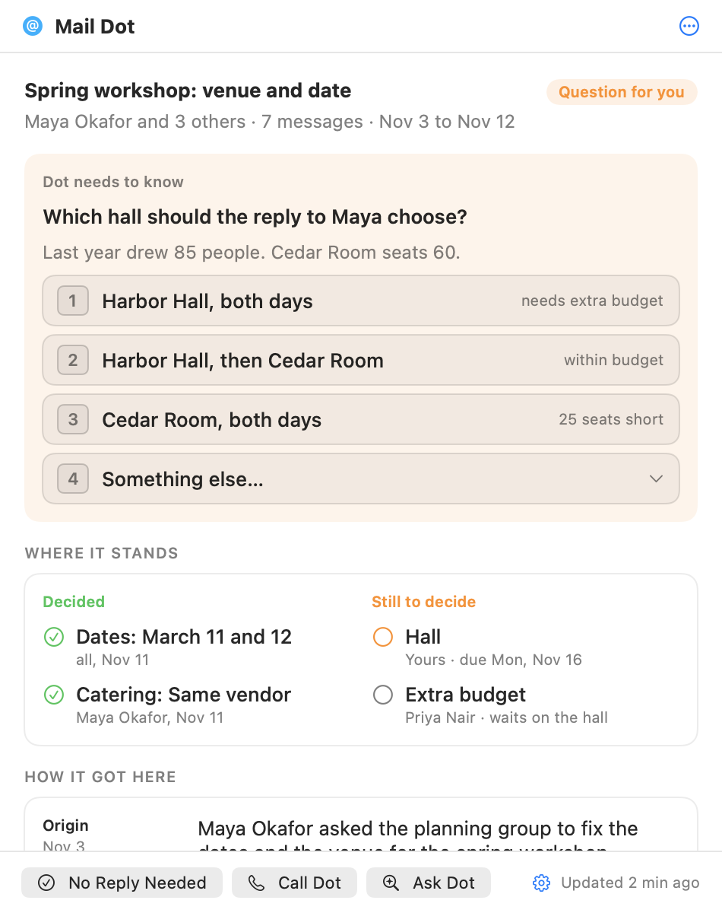
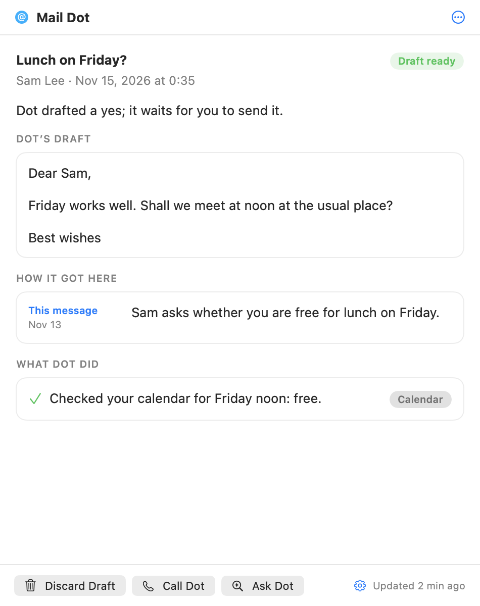
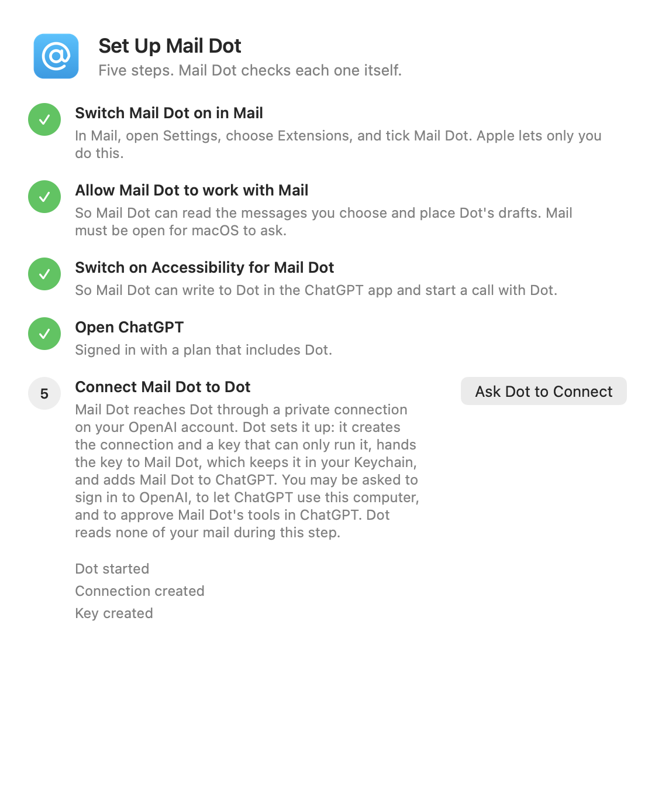

# Mail Dot

Mail Dot is an extension for Apple Mail on the Mac that brings Dot, the assistant in ChatGPT, into the mail client. It drafts replies that draw on the whole context of a correspondence, it answers questions about a mailbox in plain language, and it reports on each thread so that the state of a matter is visible at a glance. The reader works in Mail throughout. Nothing leaves the Mac as a sent message without one confirming press.

Hooner LLC publishes Mail Dot's source code under the PolyForm Noncommercial License 1.0.0. Anyone may use, study and modify it for noncommercial purposes, and commercial use requires a licence from Hooner LLC. The first public release is in testing, and the installer will appear on the [Releases page](https://github.com/JGKarlin/maildot/releases) when that testing ends.

<p align="center"></p>

## Why Mail Dot exists

Dot can already read and write mail through ChatGPT. Managing the mail of several accounts from a chat window, or by voice alone, is nevertheless unrealistic for most working days. Mail involves scanning lists, opening threads, comparing messages and editing text in place, and a mail client does all of this better than a conversation does. The mail client therefore remains necessary.

Apple's mail client, however, has changed little since the early days of mailbox-based mail programs. Its search matches words and cannot answer a question. Its drafting help knows nothing of earlier correspondence, the calendar or the documents a reply depends on. The integration of language models into the client is still lacking, both for composing drafts and for searching by meaning.

Mail Dot joins the two. Mail remains the place where mail is read, sorted and sent. Dot supplies the reasoning, the writing and the search, and its work appears inside Mail on the message it concerns.

## What Mail Dot does

Mail Dot has three functions: drafting, search and reports.

### Drafting in context

When an important message arrives, or when the reader opens one, Mail Dot offers it to Dot. Dot reads the thread, consults earlier mail with the same person, the calendar and any other sources connected to it in ChatGPT, and writes a reply in the language of the message. The draft waits in Mail Dot's panel in the reply window. The reader inserts it into the message, saves it to Drafts, or sends it, and can ask Dot to revise it in a sentence or by voice.

Where the context does not settle what the reply should say, Dot asks one question and offers concrete answers. A single press answers it, and Dot then writes the draft.

<p align="center"></p>

Mail Dot filters what it offers to Dot. Bulk mail, mailing lists, receipts, account notices, one-time codes and automated messages stay out, and each account has its own switch for automatic drafts. The reader's own drafting rules, such as how to open a message or how formal to be, accompany every request, and so do notes on how to write to a particular person.

<p align="center"></p>

### Searching mail by meaning

Ask Dot is a floating bar, opened with Shift-Option-Command-F, that takes a question about the mailbox as a whole. The question may ask for a message ("find the file Priya sent about the budget") or for what the mail says about a matter ("when is the workshop, and who has confirmed?"). Filters narrow the search by account, period, direction, correspondent and attachments.

Dot performs the search with its own mail tools and answers in sentences. Every statement cites the message it rests on, and each citation opens that message in Mail. A history keeps earlier questions and their answers.

<p align="center"></p>

### Reports on threads

For each message it handles, Dot reports on the thread: how it began, how it developed, what has been decided, what remains open and who must act. A banner on the message in Mail gives the state in a word or two, such as "Draft ready", "Question for you" or "No reply needed", and the Mail Dot window shows the full report. The window offers three layouts, named Briefing, Storyline and Ledger.

The report turns a long thread into a short account of where a matter stands, and it tracks the commitments that mail creates. When a message sets a meeting, the report shows it with a button that adds it to the calendar.

<p align="center"></p>

<p align="center"></p>

## Using Mail Dot

Mail Dot appears in three places in Mail.

On a message, a banner states what Dot has done with it. The banner's button, Open Mail Dot, opens the report on that message and its thread. From the report the reader can ask for a draft, discard one, mark a message as needing no reply, start a voice call with Dot about it, or open Ask Dot.

In a reply window, the Mail Dot button in the toolbar opens the panel shown at the top of this page. Insert places Dot's draft at the head of the reply and leaves the quoted mail untouched. Save Draft places it and saves the message to Drafts. Send places it and asks for one confirmation that names the recipients, after which Mail sends the message. No Reply dismisses the draft. The field beneath takes an instruction for revising the draft, and Call Dot opens a voice call for the same purpose.

Anywhere in Mail, Shift-Option-Command-F opens Ask Dot.

Mail Dot's settings hold the list of accounts with their switches, the drafting rules, the choice of layout and the state of the connection to Dot.

## How Mail Dot works

Mail Dot does not call the OpenAI API, and it contains no language model. It uses no API credits and sends no prompts to a model endpoint. The reasoning is done by the reader's own Dot, inside the reader's ChatGPT account, with the memory, connectors and schedule that Dot already has. Mail Dot is the bridge between that Dot and Apple Mail.

### The connection

The bridge is a private connection that OpenAI calls a Secure MCP Tunnel. Mail Dot runs a small helper on the Mac that offers Dot a fixed set of tools: to read the message the reader has shared, to read mail in the folders the reader has allowed, to propose a draft, to report on a thread, and to ask the reader a question. OpenAI's open-source `tunnel-client`, included in the app, opens an outbound connection from the Mac to OpenAI. Dot reaches the helper through that connection as a private plugin in the reader's ChatGPT account. The Mac accepts no incoming connections, and the plugin is visible to no one else.

```
Apple Mail  <->  Mail Dot on the Mac  <->  tunnel-client  ==outbound==>  OpenAI tunnel  <->  Dot in ChatGPT
(extension)      (helper with tools)       (inside the app)                                 (the reader's account)
```

The key that runs the connection is restricted to that one purpose. It cannot run a model or read anything in the OpenAI account. Mail Dot keeps it in the macOS Keychain.

### No ChatGPT window is required

Dot runs in OpenAI's cloud, not on the Mac. When something happens in Mail that concerns Dot, such as the arrival of an important message or a press of a button in the panel, Mail Dot's helper notifies ChatGPT with a signed message over HTTPS, and Dot wakes, calls the tools it needs through the tunnel, and returns its result. The ChatGPT app therefore does not need to be open for drafting, search or reports. Mail Dot starts its connection at login and keeps it alive in the background, and an hourly task in Dot renews Dot's subscription to Mail Dot's notifications.

The ChatGPT app is needed on two occasions only: during first-time setup, and for a voice call with Dot, which is a ChatGPT call that Mail Dot opens.

The Mac must be awake, logged in and online for Dot to reach Mail. Requests made while it sleeps wait until it wakes.

### The parts

Mail Dot consists of four parts, all inside one app. The Mail extension draws the banner, the panel and the settings inside Mail. A background app carries out actions in Mail, using the macOS permissions for automation and accessibility that the reader grants. The helper speaks the Model Context Protocol to Dot and stores Mail Dot's state. The tunnel client keeps the connection to OpenAI.

### How mail reaches Dot

Mail accounts reach Dot by one of two routes. A Gmail or Google Workspace account uses the Gmail connector that Dot already has in ChatGPT. Any other account, such as iCloud, is read through Mail on the Mac, and only in the folders the reader has allowed for that account.

### Sending

Mail Dot places text in a message by operating Mail on the reader's behalf, and Mail itself sends the message. In the send path, Mail Dot shows the recipients and the opening of the text and waits for one press. Dot has no tool that can give that confirmation, and a message that changes after the confirmation is not sent. Text inside a message is treated as data and can never authorise an action.

## Requirements

Mail Dot needs a Mac with Apple silicon, Apple Mail with at least one account, and a ChatGPT plan that includes Dot. It is developed and tested on macOS 27. The ChatGPT app for Mac is needed for setup and for voice calls.

## Installation and setup

The installer places Mail Dot in the Applications folder and opens a setup window with five steps, each of which Mail Dot checks for itself.

<p align="center"></p>

The first three steps are permissions that macOS reserves for the person at the keyboard: switching the extension on in Mail's settings, allowing Mail Dot to work with Mail, and switching on Accessibility. The fourth is to open ChatGPT. In the fifth, Mail Dot asks Dot to make the connection. Dot creates the tunnel and its restricted key in the reader's OpenAI account, hands the key to Mail Dot, and adds Mail Dot to ChatGPT as a private plugin. The reader may be asked to sign in to OpenAI and to approve Mail Dot's tools in ChatGPT.

This flow is the part of the release still under test. This page will be revised to match the released installer.

## Privacy

Mail Dot has no server of its own and collects nothing. It contains no analytics and sends nothing to its publisher or developer. The text of a message goes to the reader's own ChatGPT account, and only when the reader shares it, when Mail Dot offers it for a draft, or when Dot looks it up to answer a question. Mail Dot stores its settings, Dot's drafts and Dot's reports on the Mac, in the reader's user account. The [privacy statement](PRIVACY.md) gives the details.

## Limits

Drafts are plain text. Placing a draft in Mail requires a Latin keyboard layout to be selected at that moment. The interface follows the system language in 47 languages, of which all but English and Japanese are machine translations that no native speaker has reviewed. Because Mail Dot operates Mail on the reader's behalf, an update to macOS or to ChatGPT can interrupt it until Mail Dot is updated in turn.

## Building from source

The project uses Swift 6, SwiftUI and MailKit, and generates its Xcode project with XcodeGen.

```sh
cp Config/Local.example.xcconfig Config/Local.xcconfig   # then set your own developer team ID
brew install openai/tools/tunnel-client
Tools/vendor-tunnel-client.sh
xcodegen generate
xcodebuild -project MailDot.xcodeproj -scheme MailDot -configuration Release -derivedDataPath build build
swift test --disable-sandbox --disable-swift-testing
```

`Sources/BridgeCore` holds the tools, the stores and the protocol. `Sources/BridgeAutomation` holds the code that operates Mail. `Targets` holds the Mail extension, the background app, the helper and the connection launcher.

## Removing Mail Dot

`Tools/Remove Mail Dot.command` removes the app, its Mail extension, its background helper and its stored data from the Mac, and moves them to the Trash. The Mail Dot plugin and the task that keeps Mail Dot connected are then deleted in ChatGPT.

## Reporting problems

Problems and questions belong on the [Issues page](https://github.com/JGKarlin/maildot/issues). Reports should not include the text of real mail or any key. [SECURITY.md](SECURITY.md) explains how to report a security problem privately.

## Supporting Mail Dot

Mail Dot is free for noncommercial use. Readers who find it useful may [leave a tip](https://donate.stripe.com/6oU4gA7Qm7Gl3103T333W00).

## Credits and licence

© 2026 Hooner LLC. Developed by Jason G. Karlin.

Mail Dot is licensed under the [PolyForm Noncommercial License 1.0.0](LICENSE). The licence permits use, modification and sharing for noncommercial purposes, which include personal use, research, and use by educational, charitable and public organisations. It does not permit commercial use. Commercial licences are available from Hooner LLC; open an issue on this repository to ask for one.

Mail Dot includes OpenAI's `tunnel-client`, which keeps its own Apache License 2.0; see [NOTICE](NOTICE). Mail Dot is an independent project and is not made or endorsed by OpenAI or Apple. The software is provided as it is, without warranty of any kind.
