# Mail Dot

Mail Dot brings Dot, ChatGPT's always-on agent, into Apple Mail on the Mac. Dot runs in the cloud on its own computer and keeps working between conversations, and Mail Dot gives it a private connection to your mail. Dot drafts replies that draw on the whole correspondence, answers questions about your mail in plain language with the messages it relied on, and reports on each thread so that you can see at a glance what is decided, what is open and what waits on you. You stay in Mail throughout, and nothing is sent until you press Send.

**Mail Dot is free for personal and noncommercial use.** Download the installer from the [Releases page](https://github.com/JGKarlin/maildot/releases); it is signed and notarized, and it updates itself. The source is published under the PolyForm Noncommercial License.

<p align="center">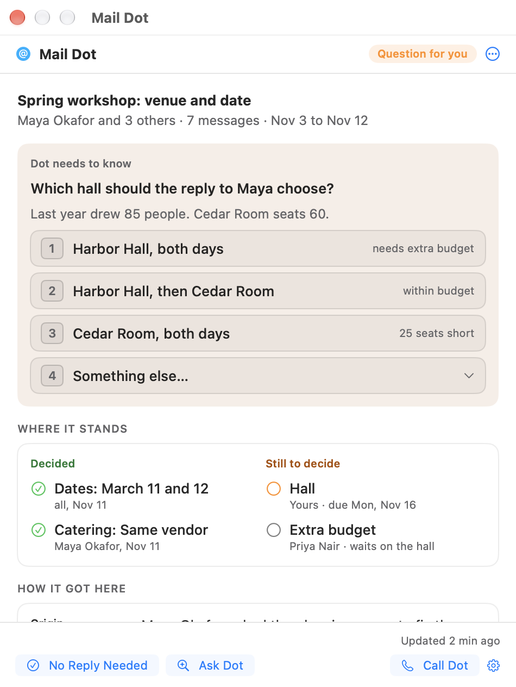</p>

## Why Mail Dot

Dot can already read and write mail in ChatGPT, but working through several accounts in a chat window, or by voice alone, does not suit most working days. Scanning lists, opening threads and editing text in place are what a mail client does best. Apple Mail, however, still searches only by words and drafts without knowledge of earlier correspondence, the calendar or the documents a reply depends on.

Mail Dot joins the two. Mail remains the place where mail is read, sorted and sent; Dot supplies the reasoning, the writing and the search, and its work appears in Mail on the message it concerns.

## What Mail Dot does

### Drafts replies in context

When an important message arrives, or when you open one, Mail Dot offers it to Dot. Dot reads the thread, earlier mail with the same person, your calendar and any other sources connected to it in ChatGPT, and writes a reply in the language of the message. The draft waits in Mail Dot's panel in the reply window, where you insert it, save it to Drafts or send it, and can ask Dot to revise it in a sentence or by voice.

Where the context does not settle the reply, Dot asks one question with concrete answers, and a single press answers it. Mail Dot keeps your answer so that Dot does not ask again, and shows a draft already written before any question.

<p align="center"></p>

Mail Dot offers Dot only mail worth answering: bulk mail, mailing lists, receipts, account notices, one-time codes and automated messages stay out, and each account has its own switch for automatic drafts. Your drafting rules, such as how to open a message or how formal to be, go with every request, together with any notes on how to write to a particular person. A request you make yourself goes ahead of the automatic checks, and while Dot is starting the panel says how many requests are ahead of yours.

<p align="center">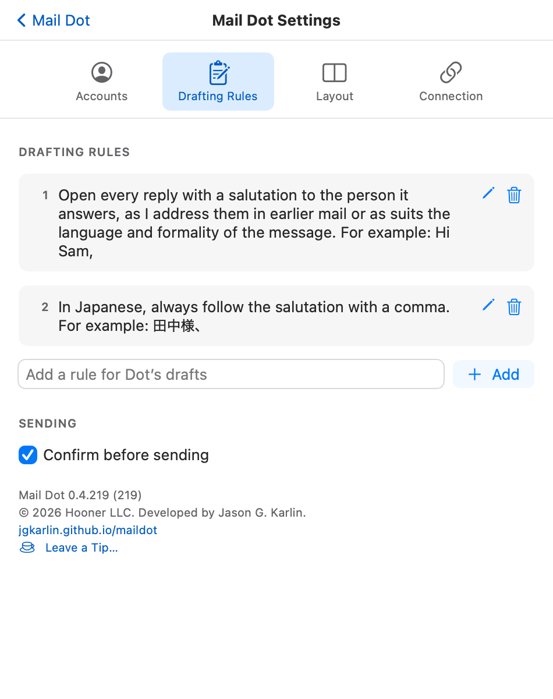</p>

<p align="center">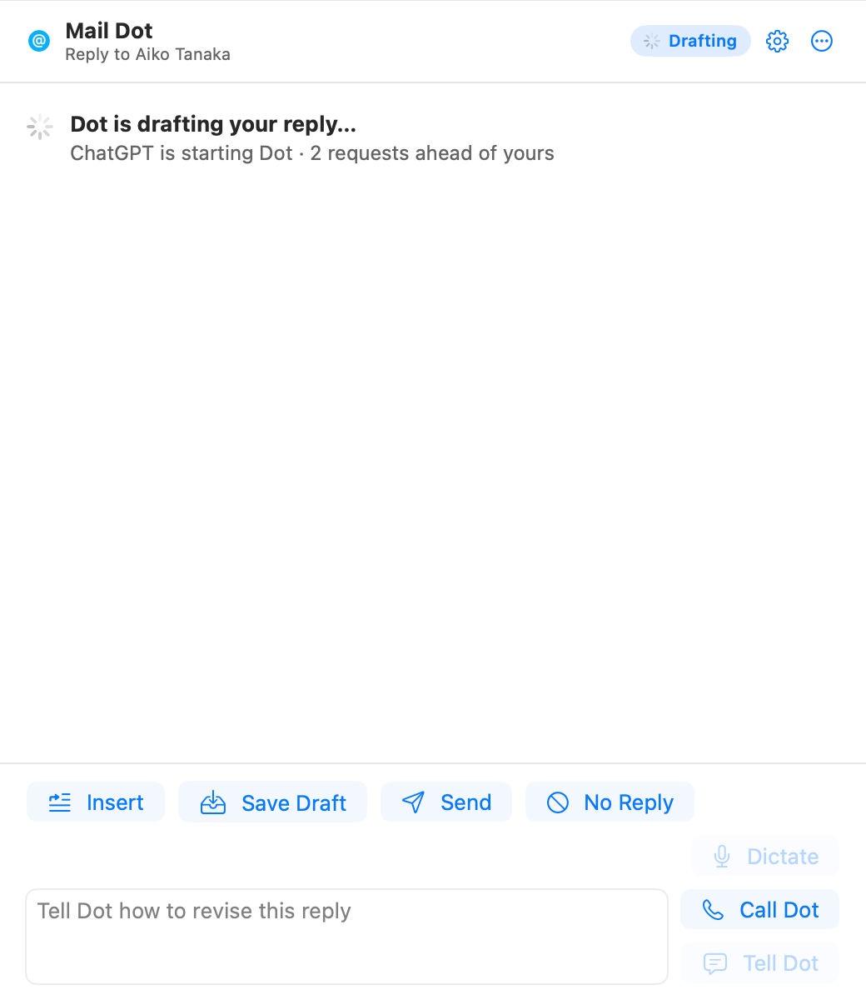</p>

### Answers questions about your mail

Ask Dot opens from Mail Dot's icon in any message's header, just below the date, from the Ask Dot button at the bottom of the Mail Dot window, or anywhere in Mail with Shift-Option-Command-F. It takes a question about your mailbox as a whole: a message to find ("the file Priya sent about the budget") or what your mail says about a matter ("when is the workshop, and who has confirmed?"). Filters narrow it by account, period, direction, correspondent and attachments. Dot answers in sentences, and every statement cites the message it rests on; each citation opens that message, and Mail Dot marks any that Mail does not hold. A line for each account says what Dot searched there, with a filled check where Mail Dot saw the search itself and an outlined one where it has only Dot's word. A history keeps earlier questions and answers.

<p align="center">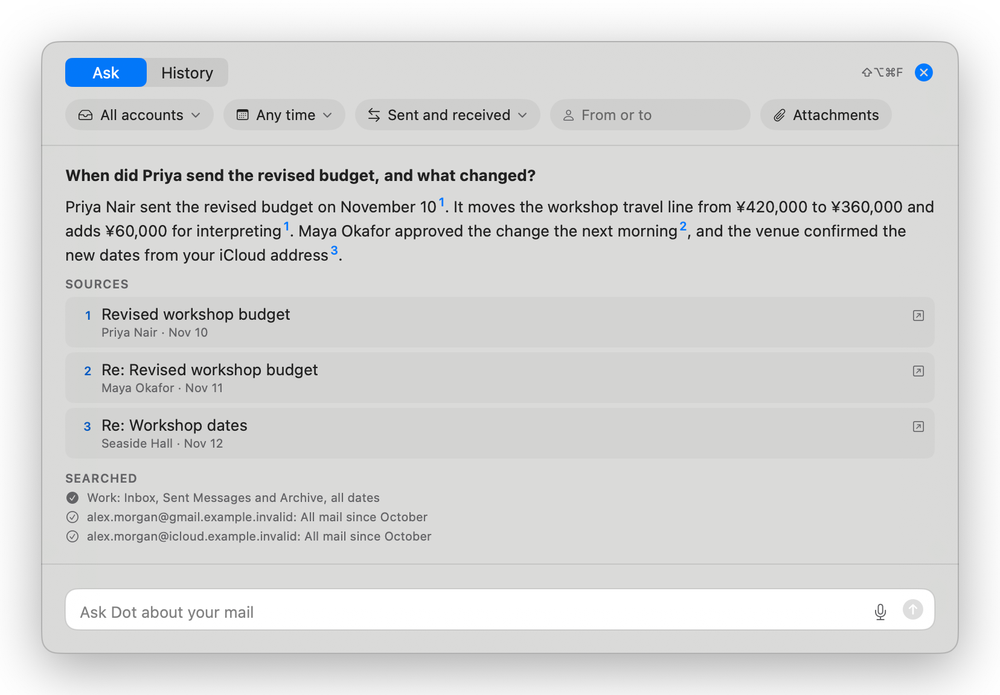</p>

Gmail and iCloud are searched on the provider's servers through their connectors. For every other account Mail Dot builds an encrypted search index on the Mac, covering only the folders you allow and kept in step with Mail. It holds each message's sender, date, subject and own text, without the quoted history. It finds messages by their words in any language, Japanese included. **Search by Meaning**, chosen per account under Accounts in Mail Dot's settings, adds embeddings made on the Mac by the language model built into macOS (which macOS may first download from Apple), so a question also finds messages that concern the same matter in different words. Each account's row shows its progress, and unticking it removes that account's embeddings. To read past mail while Mail is closed, Search by Meaning asks for Full Disk Access, which macOS grants only for the whole disk; Mail Dot reads only the Mail folder at `~/Library/Mail`, writes nothing there and skips junk and deleted mail. Without that access it reads through Mail, which works only while Mail is open.

<p align="center">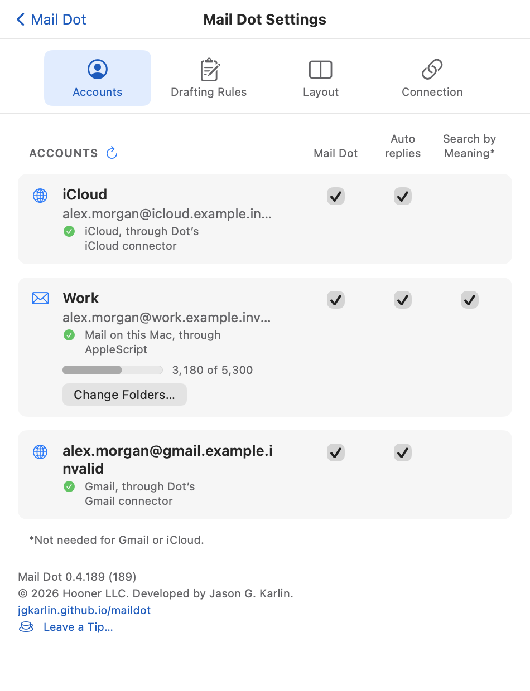</p>

### Reports on every thread

For each message it handles, Dot reports on the thread: how it began, how it developed, what has been decided, what remains open and who must act. A banner on the message gives the state: "Checking" while Dot decides whether a reply is needed, "Drafting" while it writes, then "Draft ready", "Question for you", "No reply needed", or "Replied" once you have answered, however you did it. Mail you wrote carries no banner.

The banner's Open Mail Dot button opens the Mail Dot window over the message. It shows the state at the top, beside the ⋯ menu, then what needs you (Dot's question or its draft), then where the matter stands, how the thread got there, any meeting the mail sets with a button that adds it to your calendar, and what Dot did. When you answer Dot's question, the matter moves to Decided at once. The buttons at the bottom fit the state: No Reply Needed, Open in Reply, Discard Draft and Ask Dot on the left, then Call Dot and the settings gear at the right.

<p align="center">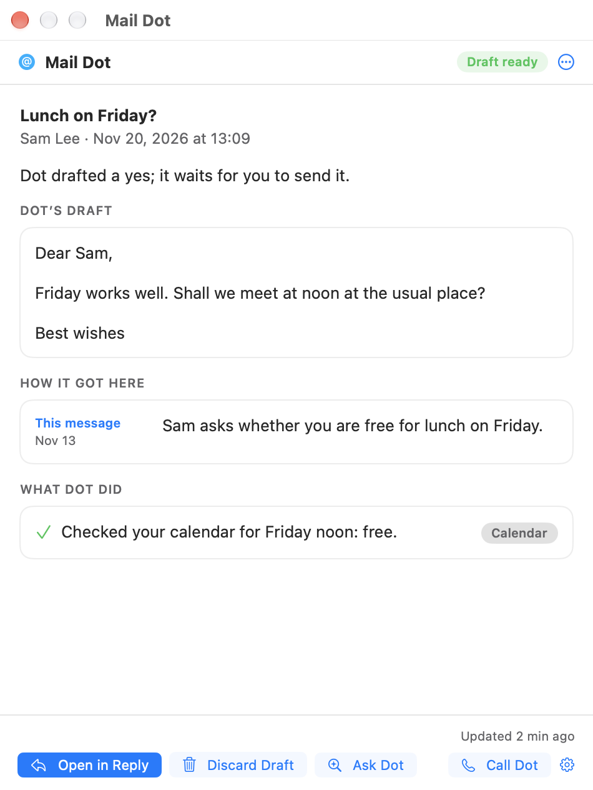</p>

#### Three views

Choose how the window lays out a report under Layout in Mail Dot's settings; the choice applies to every window.

<p align="center">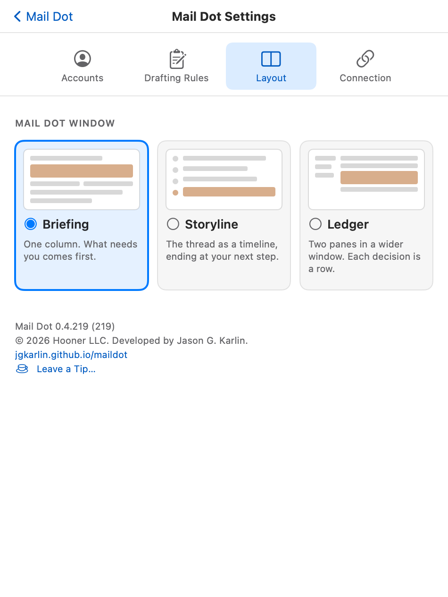</p>

**Briefing**, the default and the view at the top of this page, is one column with what needs you first. It suits a quick decision.

**Storyline** shows the thread as a timeline: what waits on you, then the message that began it, each development, the points decided and the latest message with any meeting, ending at your next step and its due date. It suits a long thread whose history matters.

<p align="center">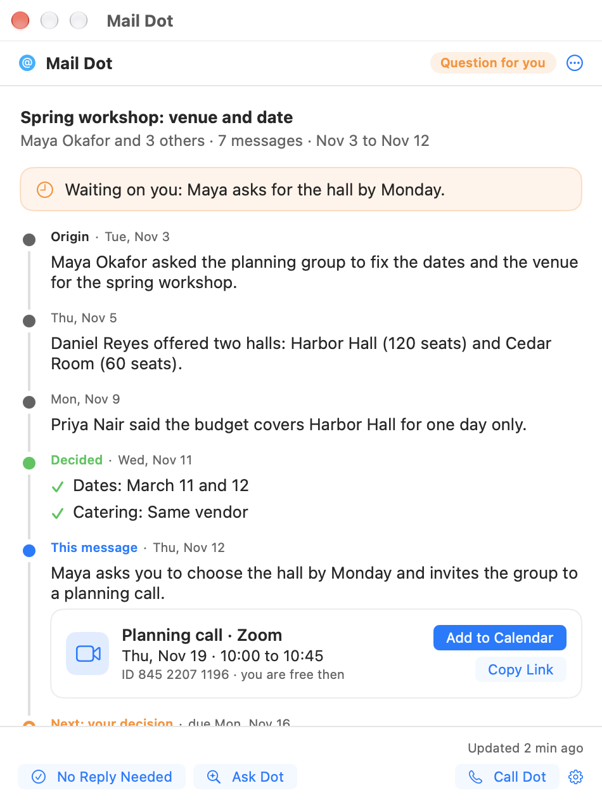</p>

**Ledger** uses two panes in a wider window: the thread report (Origin, Development, Now) and what Dot did on the left, and each decision as a row on the right, marked decided or open with who and when. The decision that waits on you opens in place with Dot's question, its answers and a box for your reply. It suits a matter with many decisions, and needs about 820 by 730 points; on a smaller screen the window shows Briefing.

<p align="center">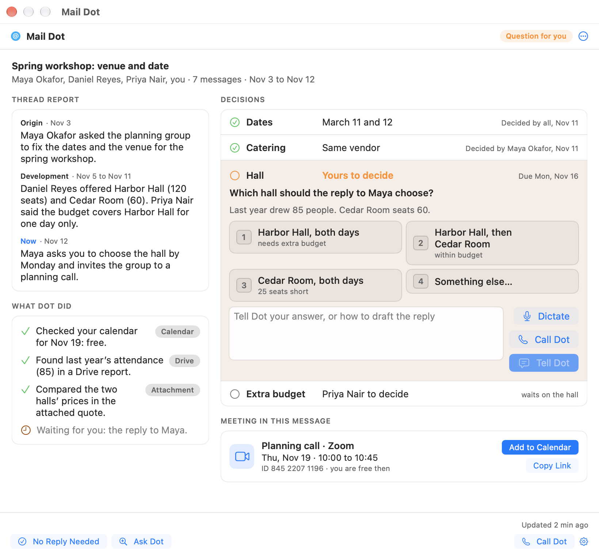</p>

## Which accounts Mail Dot works with

**Gmail and iCloud work only through their plugin connectors in ChatGPT. Reading through Mail is only for accounts that have no connector.**

| Account | How Dot reads it | How Dot searches it |
| --- | --- | --- |
| Gmail, Google Workspace | ChatGPT's Gmail connector, required | On Google's servers, through the connector |
| iCloud | ChatGPT's iCloud Mail connector, required | On Apple's servers, through the connector |
| Any account without a connector, such as Exchange or another IMAP service | Through Mail on the Mac, in the folders you allow | In Mail Dot's encrypted index on the Mac, with Search by Meaning as an option |

Under Accounts in Mail Dot's settings, a Gmail account that is not yet connected shows Use Gmail Connector…, and an iCloud account Use iCloud Connector…. Each opens the connector's page in ChatGPT (Gmail asks for a Google sign-in, iCloud for an app-specific password created at Apple) and asks Dot to confirm. The row then moves from "Gmail connector not connected" or "iCloud connector not connected" through "Asking Dot to confirm the connection…" to "Gmail, through Dot's Gmail connector" or "iCloud, through Dot's iCloud connector", or shows Dot's reason if it could not confirm. Mail sent to another address of a connected mailbox, such as an alias Mail knows, also goes through that connector.

<p align="center">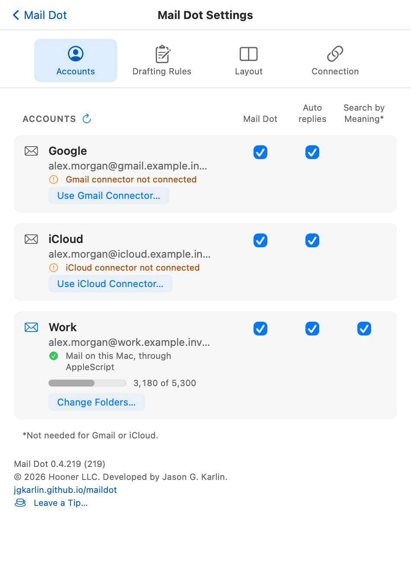</p>

A Gmail or iCloud account cannot be newly set up through Mail. The one exception is an account an earlier version was already reading through Mail: it keeps working that way until its connector is confirmed, and Mail Dot then switches it over and removes its part of the index.

## How Mail Dot protects mail

Mail is handled in two places only: by Dot, and on the Mac. What Dot receives differs by account.

**Dot does receive mail; that is Mail Dot's purpose.** For Gmail and iCloud, ChatGPT connects to the provider directly, through the Google sign-in or the iCloud app-specific password you give it, which ChatGPT keeps in order to connect. Dot can then read the whole mailbox on the provider's servers; Mail Dot holds no copy of that mail and plays no part in what Dot sees there. For an account without a connector, Mail Dot limits what Dot receives: passages from at most 25 messages per search and the full text of at most five per read, though Dot may make several requests for one question, and only from the folders you allow. Dot never receives the index or a whole mailbox. Whatever Dot reads, from any account, is handled by OpenAI under your ChatGPT account and OpenAI's terms.

**What Mail Dot keeps stays on the Mac.** Its settings, Dot's drafts and reports, and the search index live in your user account. The index is encrypted with SQLCipher under a key made on the Mac and held in your login Keychain, readable only by Mail Dot and its helper; the Search by Meaning embeddings are stored inside it; it is kept out of Time Machine; and removing Mail Dot deletes it and its key.

**Mail Dot collects nothing.** It has no server, contains no analytics, and sends nothing to its publisher. Besides your ChatGPT, its only connection is a daily check with GitHub for updates, which carries nothing about your mail. To find ChatGPT's controls in any language, it reads their names from the ChatGPT app's files on the Mac and sends them nowhere. The [privacy statement](PRIVACY.md) gives the details.

## How Mail Dot works

Mail Dot does not call the OpenAI API, contains no language model and uses no API credits. The reasoning is done by your own Dot, in your ChatGPT account, with the memory, connectors and schedule it already has. Mail Dot is the bridge between that Dot and Apple Mail.

The bridge is a private connection that OpenAI calls a Secure MCP Tunnel. A small helper on the Mac offers Dot a fixed set of tools: to read the message you shared, to read and search mail in the folders you allow, to propose a draft, to report on a thread and to ask you a question. OpenAI's open-source `tunnel-client`, included in the app, opens an outbound connection to OpenAI, and Dot reaches the helper through it as a private plugin in your ChatGPT account. The Mac accepts no incoming connections, and the key that runs the connection can do nothing else; Mail Dot keeps it in the Keychain.

```
Apple Mail  <->  Mail Dot on the Mac  <->  tunnel-client  ==outbound==>  OpenAI tunnel  <->  Dot in ChatGPT
(extension)      (helper with tools)       (inside the app)                                 (your account)
```

Dot runs in OpenAI's cloud, so the ChatGPT app need not be open for drafting, search or reports. When something in Mail concerns Dot, the helper notifies ChatGPT with a signed message, and Dot wakes, calls the tools it needs and returns its result. Dot's subscriptions to these notifications last a day, and a scheduled task in Dot named Keep connected checks every six hours and renews any that are running out. The ChatGPT app is needed only for setup and for a voice call, which Mail Dot opens before passing Dot the request. The Mac must be awake, logged in and online; requests made while it sleeps wait until it wakes.

Inside the one app are four parts: the Mail extension, which draws the banner, the panel, the window and the settings; a background app, which carries out actions in Mail with the permissions you grant; the helper, which speaks the Model Context Protocol to Dot and keeps Mail Dot's state; and the tunnel client.

## Using Mail Dot

In a reply window, the Mail Dot button in the toolbar opens the panel. Insert places Dot's draft at the head of the reply and leaves the quoted mail untouched; Save Draft also saves it to Drafts; No Reply dismisses it. Send places it, brings Mail forward and asks for one confirmation naming the recipients, after which Mail sends the message; Command-Return chooses Send. With **Confirm before sending** turned off under Drafting Rules in the settings, your press of Send is the confirmation; a send Dot prepared during a voice call always waits for your confirmation on the Mac. Dot has no tool that can confirm a send, a message changed after confirmation is not sent, and text inside a message can never authorise an action. The field beneath takes an instruction for revising the draft, typed or spoken through Dictate; Tell Dot sends it, and Call Dot opens a voice call for the same purpose.

<p align="center">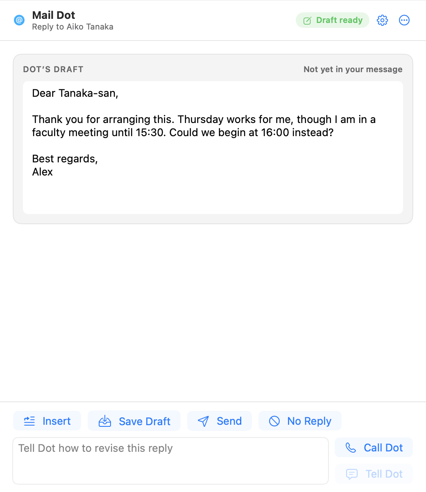</p>

Mail Dot's settings open from the gear at the bottom right of every Mail Dot panel, including the Mail Dot window and the reply panel: Accounts, Drafting Rules (with Sending), Layout and Connection.

## Requirements

A Mac with Apple silicon running macOS 14 or later (developed and tested on macOS 27), Apple Mail with at least one account, and a ChatGPT plan that includes Dot, with the ChatGPT app for Mac for setup and voice calls. Gmail and iCloud accounts need their connectors turned on in ChatGPT. Setup has Dot work on the Mac and in the browser, so Dot must be allowed to work on this Mac, and it uses your OpenAI Platform account at platform.openai.com to create the private connection. A ChatGPT workspace that does not allow custom plugins cannot complete setup.

## Installation and setup

Installation takes five steps, and Mail Dot checks each one for itself.

### 1. Run the installer

Download the installer, a file named like `Mail-Dot-0.4.232.pkg`, from the [Releases page](https://github.com/JGKarlin/maildot/releases); its SHA-256 checksum is in the release notes. Quit Mail, then open the installer and follow it; it will not continue while Mail is open. It places Mail Dot in Applications and opens it.

### 2. Follow the setup window

Set Up Mail Dot shows four steps and opens again by itself whenever Mail Dot starts before setup is complete.

<p align="center"></p>

The first three are permissions only you can give: Turn on Accessibility for Mail Dot, so that it can write to Dot in ChatGPT and start calls; Allow Mail Dot to work with Mail, so that it can read the messages you choose and place Dot's drafts (Mail must be open for macOS to ask); and Turn on Mail Dot in Mail, the extension switch in the next step.

The fourth, Connect Mail Dot to Dot, starts by itself. Mail Dot opens ChatGPT and asks Dot to create a private connection in your OpenAI account and a key that runs only that connection, hand the key to Mail Dot for the Keychain, and add Mail Dot to ChatGPT as a private plugin. The window shows each stage, and setup ends on Mail Dot's own checks, not on Dot's word: both of Dot's subscriptions present, a drafting test and a settings test answered, and Keep connected run once. Dot reads no mail during setup. You may be asked to sign in to OpenAI and to approve Mail Dot's tools in ChatGPT. If ChatGPT is signed out or has no Dot, a permission was refused, or Dot stops, the window says what to do.

### 3. Turn on the extension in Mail

macOS installs a Mail extension switched off, and only you can switch it on. In Mail, choose Mail > Settings, click Extensions, and select the Mail Dot checkbox. The setup window's Open Mail button leads there.

<p align="center">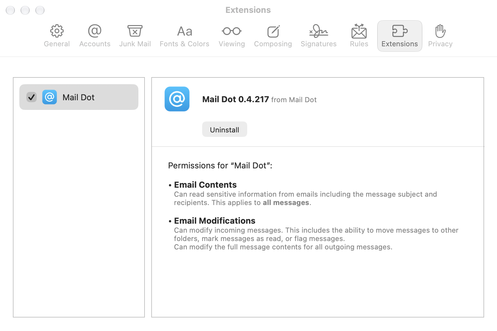</p>

### 4. Check the Connection tab

In Mail, choose File ▸ New Message, click the Mail Dot button in the new message's toolbar, then click the gear at the bottom right and choose Connection. Mail should read Allowed, Accessibility On and Dot Connected, each with a green check. ChatGPT reads Open (running) in green, or Closed in grey, which is not a fault, since the app is needed only for calls.

<p align="center">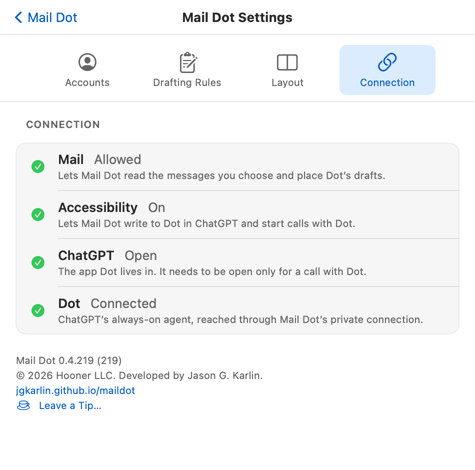</p>

A line that needs attention is orange and has a button that leads to the fix: Allow… for Mail, Open Settings… for Accessibility, Set Up… or Show Setup for Dot when setup is incomplete or stopped, and Check Again when Dot is not answering.

### 5. Connect mail accounts

Click Accounts and turn on each account with its Mail Dot checkbox. Use Gmail Connector… for Gmail and Use iCloud Connector… for iCloud; any other account is read through Mail, in the folders you choose with its Connect… button.

## Automatic updates

Once a day Mail Dot asks this repository's latest release whether a newer version exists, downloads it from GitHub in the background, and checks its signature against a key built into the app, so a file that did not come from this project is refused. The update installs when Mail quits; until then the first line of the Connection tab says one is waiting. There is no window or notification of its own, and the new version registers the Mail extension again and restarts its helper when it first starts. The installer gives the app to the person who installs it, so updates need no password for that person; another account on the same Mac, or one without administrator rights, is asked for an administrator password. Updates use [Sparkle](https://sparkle-project.org), under the MIT License.

## Limits

Drafts are plain text. Placing a draft in Mail requires a Latin keyboard layout to be selected at that moment. Search by Meaning covers the languages for which macOS supplies a model; a message in another language is still found by its words. The interface follows the system language in 47 languages. Because Mail Dot operates Mail on your behalf, an update to macOS or ChatGPT can interrupt it until Mail Dot is updated in turn.

## Removing Mail Dot

Mail Dot lives in two places: on the Mac, and in the accounts where setup created its connection.

On the Mac, quit Mail, open Mail Dot from Applications, and click Remove Mail Dot…, in Mail Dot's window or at the bottom left of the setup window. It asks once:

> **Remove Mail Dot from this Mac?**
> The app, its Mail extension, its settings and its stored data move to the Trash. Its search index of your mail and its key in your Keychain are deleted.

It also resets the permissions it was given. Where other accounts on the Mac use Mail Dot, the app stays in Applications for them. A copy of the source also has `Tools/Remove Mail Dot.command`, which does the same from Terminal.

<p align="center"></p>

In your accounts, setup created four items, each named "Mail Dot (*name*)", where *name* is the Mac account's short name; Mail Dot cannot delete them. Once it is removed, its window lists them with an Open button for each: the tunnel, under [Tunnels](https://platform.openai.com/settings/organization/tunnels), and its restricted key, under [API keys](https://platform.openai.com/settings/organization/api-keys), on OpenAI's platform; and the Mail Dot plugin and the scheduled task "Mail Dot (*name*) · Keep connected" in ChatGPT. Delete all four. The tunnel and key stay valid on OpenAI's side until you do.

## Building from source

The project uses Swift 6, SwiftUI and MailKit, and generates its Xcode project with XcodeGen.

```sh
cp Config/Local.example.xcconfig Config/Local.xcconfig   # then set your own developer team ID
brew install openai/tools/tunnel-client
Tools/vendor-tunnel-client.sh
xcodegen generate
xcodebuild -project MailDot.xcodeproj -scheme MailDot -configuration Release -derivedDataPath build build
swift test --disable-sandbox --disable-swift-testing
```

The first build downloads SQLCipher and Sparkle from their publishers, verifying SQLCipher against a checksum, so it needs a network connection. `Sources/BridgeCore` holds the tools, the stores and the protocol; `Sources/BridgeAutomation` the code that operates Mail; `Targets` the Mail extension, the background app, the helper and the connection launcher.

## Support, credits and licence

Report problems on the [Issues page](https://github.com/JGKarlin/maildot/issues), without the text of real mail or any key; [SECURITY.md](SECURITY.md) explains how to report a security problem privately. Other enquiries, including commercial licences: [mail_dot@icloud.com](mailto:mail_dot@icloud.com). Mail Dot is free for noncommercial use; if you find it useful, you may [leave a tip](https://donate.stripe.com/6oU4gA7Qm7Gl3103T333W00).

© 2026 Hooner LLC. Developed by Jason G. Karlin.

Mail Dot is licensed under the [PolyForm Noncommercial License 1.0.0](LICENSE), which permits use, modification and sharing for noncommercial purposes, including personal use, research, and use by educational, charitable and public organisations, but not commercial use. It includes software by others under their own licences ([NOTICE](NOTICE)): OpenAI's `tunnel-client` under the Apache License 2.0; SQLCipher 4.20.0, Copyright (c) 2025, ZETETIC LLC. All rights reserved. Used under the SQLCipher Community Edition Open Source License. https://www.zetetic.net/sqlcipher/; and Sparkle 2.10.1 under the MIT License.

Mail Dot is an independent project, not made or endorsed by OpenAI or Apple, and is provided as it is, without warranty of any kind. ChatGPT is a trademark of OpenAI. Apple, Mail, macOS and iCloud are trademarks of Apple Inc. Gmail and Google Workspace are trademarks of Google LLC. Their use here describes compatibility and implies no affiliation or endorsement.
